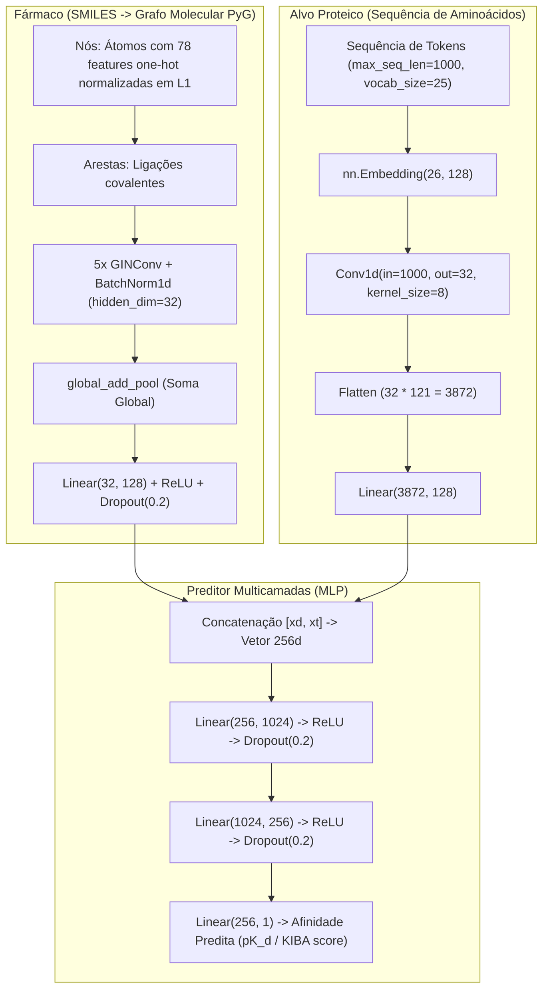
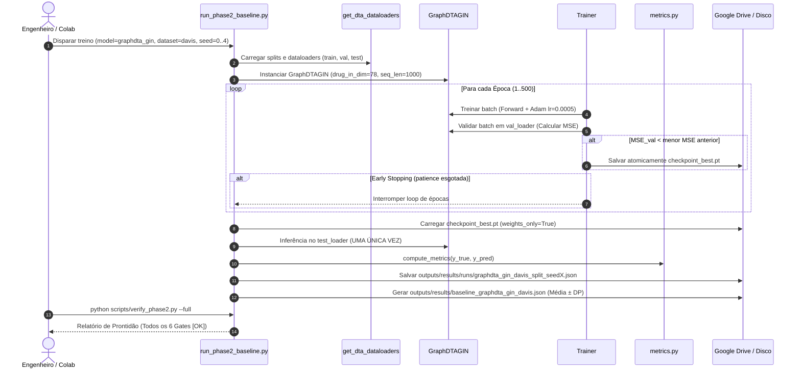

# Fase 2 — Baseline Oficial GraphDTA, Protocolo de Treinamento e Avaliação Empírica

Este documento formaliza as especificações arquiteturais, hiperparâmetros verificados, metodologia de avaliação e instruções operacionais da **Fase 2** do projeto **PhysDual-GNN**.

---

## 1. Visão Geral da Fase 2 e Justificativa Científica

O objetivo central da Fase 2 é estabelecer baselines de referência empírica rigorosos e auditáveis para predição de afinidade droga-alvo (*Drug-Target Affinity* — DTA). Para tanto, reproduzimos o modelo clássico **GraphDTA** ([Nguyen et al., 2021](https://doi.org/10.1093/bioinformatics/btaa921)), implementado no repositório de referência [`thinng/GraphDTA`](https://github.com/thinng/GraphDTA) (commit canônico `6162245c6776684b391d30610850fe7077478435`).

A arquitetura oficial adota a variante **GIN (Graph Isomorphism Network)** acoplada a um codificador convolucional 1D para a sequência do alvo proteico, combinando-os em um perceptron multicamadas (MLP).

### 1.1 Módulos Implementados no Repositório
- **Modelos e Encoders ([`src/physdual/models/graphdta.py`](file:///C:/Users/joao.francisco/Documents/dev/physdual-gnn/src/physdual/models/graphdta.py)):**
  - `GINEncoder`: Encoder de grafos moleculares com 5 camadas `GINConv`, `BatchNorm1d` e pooling por soma global (`global_add_pool`).
  - `OfficialGraphDTATargetEncoder`: Encoder oficial de sequências proteicas fiel ao código original do GraphDTA (`Conv1d(1000, 32, 8)` com flatten e projeção densa linear).
  - `DeepDTAStyleCNN3TargetEncoder`: Variante secundária com CNN de 3 camadas estilo DeepDTA (`Conv1d(128, 32, 4) -> Conv1d(32, 64, 8) -> Conv1d(64, 96, 12)` com `AdaptiveMaxPool1d(1)`).
  - `GraphDTAGIN` e `GraphDTACNN3`: Modelos compostos com verificação estrita de dimensionalidade (sem valores mágicos padrão na dimensão de entrada dos fármacos).
- **Engine de Treino e Checkpointing ([`src/physdual/training/`](file:///C:/Users/joao.francisco/Documents/dev/physdual-gnn/src/physdual/training/)):**
  - [`trainer.py`](file:///C:/Users/joao.francisco/Documents/dev/physdual-gnn/src/physdual/training/trainer.py): Loop de treino e validação com early stopping, monitoramento de MSE, gradientes limpos e isolamento estrito de teste.
  - [`checkpoint.py`](file:///C:/Users/joao.francisco/Documents/dev/physdual-gnn/src/physdual/training/checkpoint.py): Salvamento atômico (`save_checkpoint_atomic`) resistente a preempções e carregamento seguro com `torch.load(..., weights_only=True)`.
- **Métricas de Avaliação ([`src/physdual/eval/metrics.py`](file:///C:/Users/joao.francisco/Documents/dev/physdual-gnn/src/physdual/eval/metrics.py)):**
  - Cálculo validado de MSE, RMSE, Pearson ($r$), Spearman ($\rho$), $r_m^2$ e Concordance Index (CI vetorizado com fallback para `lifelines.utils.concordance_index`), além de baselines triviais (`mean_predictor` e `ridge_aa_composition`).
- **Orquestração e Verificação CLI:**
  - [`scripts/run_phase2_baseline.py`](file:///C:/Users/joao.francisco/Documents/dev/physdual-gnn/scripts/run_phase2_baseline.py): Orquestrador idempotente por run, benchmarks preliminares de GPU e agregação estatística com média $\pm$ desvio-padrão ($N=5$ seeds).
  - [`scripts/verify_phase2.py`](file:///C:/Users/joao.francisco/Documents/dev/physdual-gnn/scripts/verify_phase2.py): Verificador objetivo dos 6 Gates de Pronto da Fase 2.
  - [`notebooks/02_graphdta_baseline.ipynb`](file:///C:/Users/joao.francisco/Documents/dev/physdual-gnn/notebooks/02_graphdta_baseline.ipynb): Notebook interativo para o Google Colab.

---

## 2. Especificação Arquitetural: Baseline Oficial vs. Variante Secundária

A literatura de predição DTA pós-GraphDTA frequentemente mescla a representação molecular em grafos com codificadores proteicos de 3 camadas convolucionais inspirados no DeepDTA ([Öztürk et al., 2018](https://doi.org/10.1093/bioinformatics/bty593)). No PhysDual-GNN, estabelecemos uma distinção arquitetural formal:



### 2.1 Comparativo Paramétrico Detalhado

| Componente | Baseline Oficial (`graphdta_gin`) | Variante Secundária (`graphdta_cnn3`) | Origem no Código / Justificativa |
| :--- | :--- | :--- | :--- |
| **Status no Projeto** | **Baseline Oficial de Comparação** | **Referência Secundária** | ADR #12 |
| **Representação Molecular** | Grafo molecular PyG; nós com 78 features $L_1$-normalizadas (`v2_onehot78_l1norm`) | Idêntica à oficial (`v2_onehot78_l1norm`) | `thinng/GraphDTA:create_data.py` (ADR #10) |
| **Encoder Molecular** | GIN com 5 camadas `GINConv` (dimensão oculta 32), `BatchNorm1d`, `global_add_pool`, projeção linear para 128 | Idêntico ao oficial | `thinng/GraphDTA:models/ginconv.py` |
| **Representação do Alvo** | Sequência inteira de tokens truncada/preenchida em 1000 aminoácidos | Sequência inteira de tokens truncada/preenchida em 1000 aminoácidos | `configs/base.yaml:max_seq_len: 1000` |
| **Encoder do Alvo** | **CNN 1D Original do GraphDTA:** `Embedding(26, 128)`, `Conv1d(1000, 32, kernel_size=8)`, flatten $32 \times 121 = 3872$, `Linear(3872, 128)` | **CNN 3 Camadas estilo DeepDTA:** `Embedding(26, 128, padding_idx=0)`, transposição, `Conv1d(128, 32, 4) -> Conv1d(32, 64, 8) -> Conv1d(64, 96, 12)`, `AdaptiveMaxPool1d(1)`, `Linear(96, 128)` | Oficial: `thinng/GraphDTA:models/ginconv.py`<br>Secundária: padrão adaptado de DeepDTA |
| **Camada de Fusão (MLP)** | `Linear(256, 1024) -> ReLU -> Dropout(0.2) -> Linear(1024, 256) -> ReLU -> Dropout(0.2) -> Linear(256, 1)` | Idêntica à oficial | `thinng/GraphDTA:models/ginconv.py` |
| **Otimizador e Taxa** | Adam com `lr = 0.0005`, `weight_decay = 0.0` (sem scheduler por padrão) | Adam com `lr = 0.0005`, `weight_decay = 0.0` | Nguyen et al. (2021), Tabela 1 |
| **Batch Size e Épocas** | `batch_size = 512`, `epochs = 500` | `batch_size = 512`, `epochs = 500` | Nguyen et al. (2021), Tabela 1 |
| **Paciência Early Stopping** | `patience = 50` (`random`); `davis_cold_patience = 80` (`cold_drug`, `cold_target`) | Idêntica à oficial | Otimização para splits cold (ADR #12) |
| **Escopo de Execução** | Davis (3 splits $\times$ 5 seeds = 15 runs); KIBA condicional ao tempo de benchmark ($\le 15\text{ s/época}$) | Davis (3 splits $\times$ 5 seeds = 15 runs); KIBA secundário | Gestão de cota no Colab (ADR #12) |

> [!IMPORTANT]
> A variante `graphdta_cnn3` é explicitamente rotulada como **"GraphDTA-style com CNN estilo DeepDTA"**. Ela serve apenas para avaliar a sensibilidade da representação convolucional da sequência, **nunca como substituto da reprodução oficial do GraphDTA**.

---

## 3. Tabelas Verificadas da Literatura: Nguyen et al. (2021)

Transcrevemos abaixo os valores publicados por **Nguyen et al. (2021)** no periódico *Bioinformatics* (Vol. 37, n. 8, pp. 1140–1147, DOI: [10.1093/bioinformatics/btaa921](https://doi.org/10.1093/bioinformatics/btaa921)).

### 3.1 Tabela 1 — Hiperparâmetros de Treinamento e Configurações de Redes

| Hiperparâmetro / Arquitetura | Valor Publicado em Nguyen et al. (2021) | Implementação no PhysDual-GNN |
| :--- | :--- | :--- |
| **Otimizador** | Adam | Adam (`torch.optim.Adam`) |
| **Taxa de Aprendizado ($lr$)** | 0.0005 | 0.0005 (`configs/base.yaml`) |
| **Tamanho do Lote (*Batch size*)** | 512 | 512 (`configs/base.yaml`) |
| **Número de Épocas** | 1000 épocas (com checkpoint a cada época) | 500 épocas (com early stopping em validação) |
| **Graph Convolutional Network (GCN)** | 3 camadas convolucionais | N/A (foco no modelo campeão GIN) |
| **Graph Isomorphism Network (GIN)** | **5 camadas GINConv**, dimensão oculta 32 | **5 camadas GINConv**, dimensão oculta 32 (`GINEncoder`) |
| **Graph Attention Network (GAT)** | 2 camadas de atenção | N/A |
| **GAT-GCN Híbrido** | 2 camadas GAT + 2 camadas GCN | N/A |

### 3.2 Tabela 2 — Resultados de Referência no Dataset Davis (Setting 1 / Random Split)

A Tabela 2 do artigo original avalia o desempenho dos modelos no particionamento aleatório (*random split*) do dataset Davis. Os valores são ordenados por desempenho relativo:

| Modelo / Método | Representação Alvo / Fármaco | Concordance Index (CI) $\uparrow$ | Erro Quadrático Médio (MSE) $\downarrow$ |
| :--- | :--- | :---: | :---: |
| DeepDTA | Smith-Waterman / Pubchem-Sim | 0.790 | 0.608 |
| DeepDTA | 1D (CNN) / Pubchem-Sim | 0.835 | 0.419 |
| DeepDTA | Smith-Waterman / 1D (CNN) | 0.886 | 0.420 |
| KronRLS | Perfil de similaridade | 0.871 | 0.379 |
| SimBoost | Boosting baseado em similaridade | 0.872 | 0.282 |
| DeepDTA | 1D (CNN) / 1D (CNN) | 0.878 | 0.261 |
| WideDTA | Palavras proteicas / SMILES | 0.886 | 0.262 |
| GraphDTA (GCN) | 1D (CNN) / GCN (3 camadas) | 0.880 | 0.254 |
| GraphDTA (GAT_GCN) | 1D (CNN) / GAT-GCN | 0.881 | 0.245 |
| GraphDTA (GAT) | 1D (CNN) / GAT (2 camadas) | 0.892 | 0.232 |
| **GraphDTA (GIN)** | **1D (CNN) / GIN (5 camadas)** | **0.893** | **0.229** |

> [!NOTE]
> - O modelo **GraphDTA (GIN)** atingiu o melhor desempenho global reportado no Davis Setting 1 com **CI = 0.893** e **MSE = 0.229**.
> - As métricas para o dataset **KIBA (Tabela 3)**, bem como métricas complementares não reportadas na Tabela 2 (coeficientes de correlação de Pearson, Spearman, $r_m^2$ e resultados nos regimes de particionamento *cold-start*), constam como *"a verificar em Nguyen et al. (2021)"*.

---

## 4. Análise Crítica e Distinção Metodológica Crucial (ADR #12)

### 4.1 A Meta do Projeto (~0.89 CI) e a Saturação do Split Aleatório

O artigo original demonstra que o GraphDTA GIN já alcança **CI = 0.893** no particionamento aleatório do Davis. Esta observação conduz a uma conclusão científica de suma importância:

1. **Saturação do Particionamento Aleatório:** O split `random` permite que o mesmo fármaco ou a mesma proteína apareça simultaneamente no conjunto de treinamento e no conjunto de teste (em pares de interação distintos). Como o Davis possui apenas 68 fármacos únicos e 379 alvos de sequência única, o modelo memoriza com facilidade os perfis basais de afinidade dos ligantes e receptores.
2. **O Verdadeiro Desafio Científico do PhysDual-GNN:** O valor agregado e o poder preditivo do PhysDual-GNN não se medem no split aleatório, mas sim nos regimes de **generalização estrita (*cold-start*)**:
   - `cold_drug`: predição para moléculas químicas inteiramente novas (candidatos inéditos de reposicionamento);
   - `cold_target`: predição contra quinases ou receptores inéditos não vistos durante o treinamento;
   - Subpopulações ativas não censuradas ($pK_d > 5.0$);
   - Proteínas longas ($> 1000$ aminoácidos), nas quais a CNN 1D com truncamento sofre perda de resíduos e onde o embedding evolucionário global do **ESM-2** (Fase 3) oferece vantagem estrutural determinante.

### 4.2 Distinção Metodológica: Seleção por Teste (*Leakage*) vs. Isolamento Estrito de Teste

A análise aprofundada do script `training.py` do repositório oficial `thinng/GraphDTA` revelou a seguinte dinâmica no código original:
```python
# Trecho adaptado do training.py original do GraphDTA:
for epoch in range(NUM_EPOCHS):
    train(model, device, train_loader, optimizer, epoch + 1)
    G, P = predicting(model, device, test_loader)  # Avaliava o teste a cada época!
    ret = [rmse(G, P), mse(G, P), pearson(G, P), spearman(G, P), ci(G, P)]
    if ret[1] < best_mse:
        torch.save(model.state_dict(), model_file_name)
        best_mse = ret[1]
        best_ci = ret[-1]
```

**Diagnóstico de Risco Metodológico:**
O protocolo original do GraphDTA monitora o erro no conjunto de teste a cada época durante 1000 épocas e salva o checkpoint correspondente ao menor erro de teste. Isso constitui um **viés otimista de parada antecipada (*early stopping on test set*)**, incorrendo em vazamento indireto de dados (*data leakage* de hiperparâmetros de parada).

**Protocolo Adotado no PhysDual-GNN (Isolamento Estrito):**
1. O treinamento monitora **exclusivamente o conjunto de validação (`val_loader`)** a cada época.
2. O checkpoint ótimo (`checkpoint_best.pt`) é selecionado pelo menor MSE em `val`.
3. O conjunto de teste (`test_loader`) é avaliado **estritamente uma única vez ao término de todo o treinamento**, carregando os pesos de `checkpoint_best.pt`.
4. Os relatórios registram explicitamente o campo `test_isolation_verified: true`.

> [!WARNING]
> Devido à eliminação desse viés de seleção, é esperado que os resultados empíricos do nosso baseline oficial no Davis `random` apresentem valores ligeiramente inferiores ou mais conservadores que o CI de 0.893 publicado por Nguyen et al. (2021). Essa diferença reflete **rigor metodológico e aderência às melhores práticas de validação em aprendizado de máquina**, e não uma falha de implementação.

---

## 5. Auditoria de Duplicatas e Limitação de Mutantes para a Fase 7 (ADR #11)

Na curadoria de dados da Fase 1, auditamos as duplicatas por identificador e por conteúdo químico/biológico (`smiles` e `sequence`):

### 5.1 Colapso de Identificadores em Entidades Únicas
- **Davis:**
  - 68 `drug_id`s $\rightarrow$ 68 SMILES canônicos únicos (sem colapso químico).
  - 442 `target_id`s $\rightarrow$ **379 sequências únicas de aminoácidos** (colapso de 63 identificadores).
- **KIBA:**
  - 2.111 `drug_id`s $\rightarrow$ **2.065 SMILES canônicos únicos** (colapso de 46 moléculas por sais/isômeros).
  - 229 `target_id`s $\rightarrow$ 229 sequências únicas de aminoácidos.

### 5.2 Limitação Metodológica para Testes com Mutantes (Fase 7)
No dataset Davis bruto derivado do DeepDTA, diferentes isoformas, estados de fosforilação ou variantes mutantes de quinases (por exemplo, formas ativadas ou mutações de resistência clínica) foram indexadas sob `target_id`s distintos na matriz $Y$, mas receberam a **mesma sequência canônica *wild-type* de aminoácidos** no arquivo `proteins.txt`.

**Consequência para a Fase 7 (Resiliência a Mutações):**
> O objetivo da Fase 7 (avaliação de mutações patogênicas ou de resistência a inibidores) **não pode ser testado diretamente sobre essas duplicatas do Davis**, pois para o modelo a entrada proteica é estritamente a sequência de aminoácidos. Se a mutação pontual não estiver expressa na sequência primária, o modelo gerará predições idênticas para a quinase selvagem e para a variante mutada.
>
> Para a Fase 7, qualquer validação de sensibilidade a mutações exigirá **conjuntos dedicados contendo a sequência expressa com a substituição do resíduo (ex.: BRAF V600E, EGFR T790M) ou dados curados de ensaios com mutantes pontuais**.

---

## 6. Determinismo, Censura e Truncamento de Sequências

### 6.1 Determinismo Estrito vs. Prático em GPUs CUDA
A reprodução estrita de modelos baseados em grafos em GPUs CUDA enfrenta limitações de hardware:
- Operações de espalhamento e redução atômica (`torch_geometric.nn.global_add_pool` e `torch_scatter.scatter_add`) operam de forma assíncrona na GPU, gerando variações na ordem de soma de ponto flutuante em nível de bit.
- Para mitigar a dispersão estocástica e garantir auditabilidade:
  - Fixamos sementes globais via `set_seed(seed)` para Python `random`, `numpy` e PyTorch (`torch.manual_seed`, `torch.cuda.manual_seed_all`).
  - Executamos sistematicamente **5 seeds independentes** (`[0, 1, 2, 3, 4]`), reportando as métricas finais na forma de **média $\pm$ desvio-padrão amostral** ($ddof=1$).

### 6.2 Impacto dos 69.64% de Pares Censurados no Davis ($pK_d = 5.0$)
No ensaio experimental de Davis et al. (2011), o limite superior de medição de constante de dissociação foi de $K_d = 10.000\text{ nM}$, truncando interações nulas ou muito fracas em $pK_d = -\log_{10}(10^{-5}) = 5.0$.
- Isso gera uma concentração pontual em $5.0$ em **20.932 dos 30.056 pares (69.64%)**.
- Em razão disso, modelos ingênuos que prevêem valores próximos de $5.0$ podem alcançar MSE relativamente baixo sem aprender afinidades relativas entre inibidores potentes.
- Torna-se imperativo o uso combinado de **Concordance Index (CI)** e **Spearman ($\rho$)**, bem como a comparação com os baselines triviais (`mean_predictor` e `ridge_aa_composition`), exigida no Gate 6 da Fase 2.

### 6.3 Truncamento em 1000 Resíduos vs. Embeddings ESM-2
- No GraphDTA original, a sequência do alvo proteico é uniformemente truncada em **1000 aminoácidos** (`max_seq_len = 1000`).
- No dataset Davis, **83 quinases possuem comprimento superior a 1022 resíduos** (algumas ultrapassando 2000 aminoácidos). Com o truncamento em 1000 aminoácidos, o GraphDTA descarta completamente a porção C-terminal dessas enzimas.
- Essa restrição arquitetural do GraphDTA constitui uma das principais motivações teóricas para o PhysDual-GNN: na **Fase 3**, os embeddings pré-computados do **ESM-2** processam a proteína inteira com janela deslizante de 1022 resíduos e agregação ponderada, fornecendo uma representação contextualizada de todo o polipeptídeo sem perda de domínios catalíticos ou regulatórios.

---

## 7. Instruções Operacionais e Execução no Google Colab

### 7.1 Execução no Notebook Interativo
Abra o notebook [`notebooks/02_graphdta_baseline.ipynb`](file:///C:/Users/joao.francisco/Documents/dev/physdual-gnn/notebooks/02_graphdta_baseline.ipynb) no Google Colab com GPU (L4 ou T4):
1. Execute a célula de montagem do Google Drive e verificação de ambiente.
2. Execute a célula de benchmark de velocidade (assegura tempo $\le 15\text{ s/época}$ antes de disparar o treino completo).
3. Execute o treinamento dos baselines para o Davis (3 splits $\times$ 5 seeds).
4. Verifique a agregação estatística gerada em `outputs/results/baseline_graphdta_gin_davis.json`.

### 7.2 Execução via Linha de Comando (CLI)
A orquestração completa é executada pelo script [`scripts/run_phase2_baseline.py`](file:///C:/Users/joao.francisco/Documents/dev/physdual-gnn/scripts/run_phase2_baseline.py):

```bash
# 1. Executar benchmark preliminar de tempo (1 época) e teste rápido (dry-run):
python scripts/run_phase2_baseline.py --benchmark-only
python scripts/run_phase2_baseline.py --dry-run --dataset davis

# 2. Executar o Baseline Oficial (GraphDTA GIN) nas 5 seeds para Davis (splits random, cold_drug, cold_target):
python scripts/run_phase2_baseline.py --dataset davis --model graphdta_gin --split all --seeds 0,1,2,3,4

# 3. Executar a Variante Secundária (GraphDTA CNN3) para comparação:
python scripts/run_phase2_baseline.py --dataset davis --model graphdta_cnn3 --split all --seeds 0,1,2,3,4

# 4. Executar KIBA condicionalmente (se tempo <= 15 s/época):
python scripts/run_phase2_baseline.py --dataset kiba --model graphdta_gin --split random --seeds 0,1,2
```

### 7.3 Idempotência e Retomabilidade em Sessões Preemptivas
O orquestrador implementa persistência individual atômica:
- Cada execução salva seu resultado individual em:
  `outputs/results/runs/{model}_{dataset}_{split}_seed{seed}.json`
- Durante o treino, checkpoints de época e o melhor checkpoint de validação são salvos em:
  `outputs/checkpoints/{model}_{dataset}_{split}_seed{seed}/checkpoint_best.pt`
- Caso a sessão do Colab seja interrompida por inatividade ou preempção de GPU, o script reexecutado detecta runs já concluídas e avança automaticamente para as pendentes (`skip existing runs`).

### 7.4 Verificação Automatizada do Gate de Pronto da Fase 2
Ao término das execuções, execute o verificador formal de prontidão:

```bash
# Validação ágil de contratos, imports e roundtrip de tensores:
python scripts/verify_phase2.py --smoke

# Auditoria completa dos 6 critérios de prontidão da Fase 2:
python scripts/verify_phase2.py --full --config configs/base.yaml
```

**Critérios Auditados pelo Gate de Pronto da Fase 2:**
- **Gate 1:** Presença e integridade dos JSONs de runs individuais com todas as 6 métricas (MSE, RMSE, Pearson, Spearman, $r_m^2$, CI).
- **Gate 2:** Presença e consistência dos JSONs agregados com estatísticas amostrais (média e desvio-padrão com $ddof=1$).
- **Gate 3:** Ausência de arquivos temporários órfãos (`.tmp_*`).
- **Gate 4:** Confirmação do isolamento estrito de teste (`test_isolation_verified: true`).
- **Gate 5:** Sanidade de convergência (Davis `random` com CI $\ge 0.86$ de referência).
- **Gate 6:** Superação empírica dos baselines triviais (`mean_predictor` e `ridge_aa_composition`).

---

## 8. Diagrama do Pipeline da Fase 2



---

## 9. Auditoria Forense dos Resultados da Fase 2 e Protocolo v2 (GroupKFold de 5 Dobras - ADR #13)

### 9.1 Síntese da Auditoria Forense do Protocolo v1 (Seeds)

Após a conclusão das 9 combinações de baseline (18 runs agregadas com 5 seeds cada), a auditoria forense revelou achados cruciais para a fundamentação científica do projeto:

| Dataset / Split | Modelo | CI (Test) | MSE (Test) | Pearson ($r$) | Baseline de Promiscuidade ($\Delta\text{MSE}$) | Veredito |
| :--- | :--- | :--- | :--- | :--- | :--- | :--- |
| **Davis random** | GIN (oficial) | 0.8845 ± 0.0076 | 0.2354 ± 0.0152 | 0.8351 ± 0.0102 | -71% vs média global | **Aprovado** (reproduz Nguyen et al., 2021) |
| **Davis random** | CNN3 | 0.8895 ± 0.0079 | 0.2223 ± 0.0157 | 0.8465 ± 0.0116 | -73% vs média global | **Aprovado** (variante secundária forte) |
| **Davis cold-drug** | GIN (oficial) | 0.6930 ± 0.0210 | 0.5222 ± 0.0381 | 0.5367 ± 0.0321 | -15% vs média global | **Aprovado** (queda esperada por generalização) |
| **Davis cold-drug** | CNN3 | 0.6918 ± 0.0343 | 0.5173 ± 0.0634 | 0.5401 ± 0.0460 | -16% vs média global | **Aprovado** (comportamento idêntico ao GIN) |
| **Davis cold-target** | GIN (oficial) | 0.7282 ± 0.0245 | 0.7490 ± 0.0768 | 0.5012 ± 0.0389 | **+0.1076 vs `drug_mean_predictor`** | **Falha estrutural da CNN 1D oficial** |
| **Davis cold-target** | CNN3 | 0.7698 ± 0.0374 | 0.5684 ± 0.0792 | 0.5732 ± 0.0528 | **-0.0740 vs `drug_mean_predictor`** | **Supera baseline marginal de droga** |
| **KIBA random** | GIN (oficial) | 0.8540 ± 0.0062 | 0.1812 ± 0.0075 | 0.8482 ± 0.0070 | -74% vs média global | Abaixo do paper (CI ~0.88); seeds 1 e 3 no teto |
| **KIBA cold-drug** | GIN (oficial) | 0.7561 ± 0.0124 | 0.3814 ± 0.0195 | 0.7301 ± 0.0162 | -44% vs média global | Generalização consistente |
| **KIBA cold-target** | GIN (oficial) | 0.6582 ± 0.0189 | 0.5140 ± 0.0210 | 0.6012 ± 0.0205 | -25% vs média global | Generalização consistente |

### 9.2 Causa-Raiz no Davis Cold-Target e Papel do CNN3

No Davis `cold_target`, o codificador proteico oficial do GraphDTA (`Conv1d(1000, 32, 8) + Linear(3872, 128)`) opera sobre canais posicionais absolutos sem pooling invariante, parando na época $4.6 \pm 2.1$. O modelo memoriza os alvos de treino e se degenera em um estimador ruidoso da afinidade média de cada fármaco.

Em contrapartida, o `GraphDTACNN3` (estilo DeepDTA com 3 camadas convolucionais 1D e `AdaptiveMaxPool1d(1)`) possui invariância translacional ao longo da sequência proteica. Ele treinou até a época $81 \pm 17$ e superou o baseline marginal por fármaco, estabelecendo-se como o **baseline primário e mais rigoroso a ser batido na Fase 3 pelo PhysDual-GNN com ESM-2**.

### 9.3 Especificação do Protocolo v2 (GroupKFold de 5 Dobras - Opção C)

Conforme estabelecido no **ADR #13**, o Davis é reavaliado sob validação cruzada agrupada de 5 dobras:
1. **Atribuição Determinística e Disjunta:**
   - 5 dobras geradas com `random_state=42`.
   - `cold_drug`: agrupado por `smiles` canônico.
   - `cold_target`: agrupado por `sequence` do alvo.
   - Cada grupo/entidade aparece no conjunto de teste de exatamente uma única dobra. O conjunto de teste consolidado (*Out-of-Fold* — OOF) cobre **100% dos pares do dataset**.
2. **Validação Interna:**
   - Em cada dobra, extrai-se um conjunto de validação interno de ~10% dos grupos de treino (mesmo critério de conteúdo) para controle de early stopping (`patience=80`).
3. **Métricas Consolidadas:**
   - Média $\pm$ desvio amostral ($ddof=1$) entre as 5 dobras.
   - Métricas globais sobre todas as previsões fora da dobra (OOF pooled).
   - Métricas de classificação binária (AUROC e AUPR em $pK_d > 5.0$ e $pK_d \ge 7.0$).
   - Bootstrap agrupado no nível de cluster (*cluster-level bootstrap*, 1.000 replicações, IC 95%) para $\Delta\text{MSE}$ e $\Delta\text{CI}$ pareados contra os baselines marginais de promiscuidade (`drug_mean_predictor` e `target_mean_predictor`).
4. **Controle de Épocas no KIBA Random (Seeds 1 e 3):**
   - As seeds 1 e 3 de KIBA `random` são estendidas de 500 para 1000 épocas (`--extend-epochs`), preservando o histórico de loss e o estado do otimizador e early stopping a partir do `checkpoint_last.pt`.

