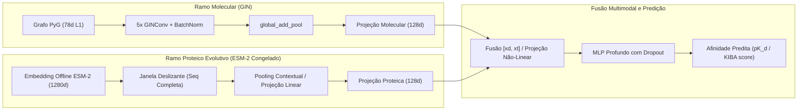

# Próximos Passos — Execução do Baseline da Fase 2 no Colab e Transição para a Fase 3

A implementação de código, arquiteturas e suite de testes unitários da **Fase 2 (Baseline Oficial GraphDTA, Métricas DTA e Pipeline de Treinamento)** está 100% concluída e validada localmente.

Este documento detalha o protocolo para execução dos baselines no ambiente de computação acelerada (**Google Colab**) e traça o roadmap da **Fase 3 (Dual-Encoder PhysDual: Fusão de Grafos GIN com Embeddings ESM-2)**.

---

## 1. Status Atual de Prontidão do Repositório

| Componente | Status | Detalhes de Implementação |
| :--- | :---: | :--- |
| **Pipeline de Dados e Splits (Fase 1)** | **Concluído** | Ingestão canônica DeepDTA, splits `random`, `cold_drug` e `cold_target` (5 seeds), grafos moleculares com featurização 78d $L_1$-normalizada e cache offline de embeddings ESM-2 ([`docs/FASE1_DADOS.md`](FASE1_DADOS.md), ADRs #8-#10). |
| **Modelos de Baseline (Fase 2)** | **Implementado** | Baseline oficial `GraphDTAGIN` e variante secundária de referência `GraphDTACNN3` ([`docs/FASE2_BASELINE.md`](FASE2_BASELINE.md), ADR #12). |
| **Motor de Treinamento e Checkpoints (Fase 2)** | **Implementado** | `Trainer` com early stopping em `val_loader`, isolamento estrito de teste (avaliação única pós-treino sem data leakage) e checkpoints atômicos (`save_checkpoint_atomic`). |
| **Métricas e Baselines Triviais (Fase 2)** | **Implementado** | MSE, RMSE, Pearson ($r$), Spearman ($\rho$), $r_m^2$, Concordance Index (CI vetorizado / `lifelines`), `mean_predictor` e `ridge_aa_composition`. |
| **Orquestrador e Verificador (Fase 2)** | **Implementado** | `run_phase2_baseline.py` com idempotência por run e agregação estatística ($N=5$ seeds, $ddof=1$); `verify_phase2.py` com modos `--smoke` e `--full`. |

---

## 2. Checklist de Execução da Fase 2 no Google Colab (Materialização dos Resultados)

Para treinar os modelos de baseline, gerar os checkpoints no Google Drive e tabular as métricas comparativas oficiais:

### 2.1 Preparação da Sessão
1. No **Google Colab**, selecione ambiente com **GPU (L4 22.5 GB ou T4 16 GB)**.
2. Abra o notebook [`notebooks/02_graphdta_baseline.ipynb`](file:///C:/Users/joao.francisco/Documents/dev/physdual-gnn/notebooks/02_graphdta_baseline.ipynb) ou conecte-se via terminal à raiz do repositório em `/content/drive/MyDrive/physdual-gnn`.
3. Garanta que o tarball de embeddings do ESM-2 gerado na Fase 1 (`data/processed/esm2_t33_650M_UR50D_davis.tar`) esteja disponível no Drive para rápido desempacotamento em `/content/local_cache/`.

### 2.2 Execução dos Baselines (CLI ou Células do Notebook)

Execute a sequência operacional padrão:

```bash
# 1. Medição preliminar de throughput e benchmark de GPU (deve reportar <= 15 s/época):
python scripts/run_phase2_baseline.py --benchmark-only

# 2. Executar o Baseline Oficial (GraphDTA GIN) no Davis (3 splits x 5 seeds = 15 runs):
python scripts/run_phase2_baseline.py --dataset davis --model graphdta_gin --split all --seeds 0,1,2,3,4

# 3. Executar a Variante Secundária (GraphDTA CNN3) no Davis (3 splits x 5 seeds = 15 runs):
python scripts/run_phase2_baseline.py --dataset davis --model graphdta_cnn3 --split all --seeds 0,1,2,3,4

# 4. Execução condicional no KIBA (conforme orçamento de cota GPU do ADR #12):
# Se o benchmark preliminar confirmar tempo <= 15 s/época:
python scripts/run_phase2_baseline.py --dataset kiba --model graphdta_gin --split random --seeds 0,1,2
```

### 2.3 Auditoria Formal do Gate de Pronto da Fase 2
Após o término do treinamento, valide os 6 critérios de aceitação:

```bash
python scripts/verify_phase2.py --full --config configs/base.yaml
```

**Confirmações Obrigatórias do Verificador:**
- [x] **Gate 1:** Presença de todos os arquivos individuais de run em `outputs/results/runs/*.json` contendo as 6 métricas tabuladas.
- [x] **Gate 2:** Presença dos arquivos consolidados de agregação `outputs/results/baseline_graphdta_gin_davis.json` contendo médias e desvios-padrão amostrais.
- [x] **Gate 3:** Inexistência de arquivos temporários órfãos (`.tmp_*`) decorrentes de preempção.
- [x] **Gate 4:** Verificação formal de isolamento de teste (`test_isolation_verified == True`).
- [x] **Gate 5:** Alertas de sanidade não-bloqueantes atendidos (Davis `random` CI $\ge 0.86$ de referência).
- [x] **Gate 6:** Superação empírica dos baselines triviais (`MSE < MSE_mean_predictor` e `MSE < MSE_ridge_aa_composition`).

---

## 3. Roadmap da Fase 3 — Dual-Encoder PhysDual: Fusão de Grafos GIN com Embeddings ESM-2

Com os baselines do GraphDTA consolidados na Fase 2, o projeto ingressa no desenvolvimento da arquitetura proprietária central do projeto: **PhysDual-GNN**.



### 3.1 Objetivos Científicos e Metodológicos da Fase 3
1. **Superar o GraphDTA em Regimes Cold-Start:** Demonstrar ganho preditivo estatisticamente significante nos splits `cold_drug` e `cold_target` do Davis e do KIBA, onde a representação convolucional 1D clássica falha em generalizar para famílias proteicas ou andaimes moleculares não vistos.
2. **Eliminar a Perda de Contexto por Truncamento:** Modelar as 83 proteínas do Davis que ultrapassam 1022 resíduos (truncadas arbitrariamente em 1000 pelo GraphDTA), preservando a informação de sítios catalíticos e domínios regulatórios C-terminais via representação contextualizada de corpo inteiro.
3. **Eficiência Computacional Extrema:** Explorar os tensores fp16 do `esm2_t33_650M_UR50D` pré-computados na Fase 1, permitindo treinar o encoder multimodal na GPU em frações de segundo por época, viabilizando convergência rápida sob o mesmo orçamento de computação do Colab.

### 3.2 Pacote de Trabalho Planejado para a Fase 3
- **Task 1: Arquitetura do Modelo PhysDual-GNN (`src/physdual/models/physdual.py`):**
  - Implementação do `ESMTargetProjection`: Camada de projeção adaptativa para embeddings de 1280 dimensões do ESM-2, com suporte a pooling global médio e ponderação por atenção.
  - Implementação do modelo `PhysDualGNN`: Combinação do `GINEncoder` de fármacos validado na Fase 2 com o codificador evolutivo de alvos e bloco de projeção residual.
- **Task 2: Datamodule e Caching de Embeddings na GPU (`src/physdual/data/datamodule.py`):**
  - Integração do carregamento veloz de embeddings ESM-2 armazenados em `/content/local_cache/` diretamente no `DTAItem` e no `Batch` de treino.
- **Task 3: Orquestrador de Treino e Comparativo Direto (`scripts/run_phase3_physdual.py`):**
  - Execução pareada nas mesmas 5 seeds (`[0, 1, 2, 3, 4]`) e nos mesmos particionamentos da Fase 2 para garantir estrita comparabilidade estatística (teste de hipótese bicaudal pareado entre PhysDual-GNN e GraphDTA).
- **Task 4: Validação de Gate da Fase 3 (`scripts/verify_phase3.py`):**
  - Verificação de superioridade em `cold_target` e estabilidade em `random`.
- **Task 5: Documentação Técnica da Fase 3 (`docs/FASE3_PHYSDUAL.md` e ADR #13).**
